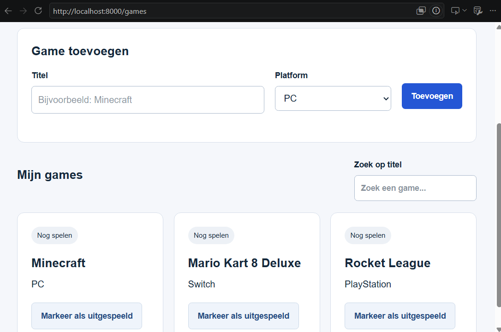
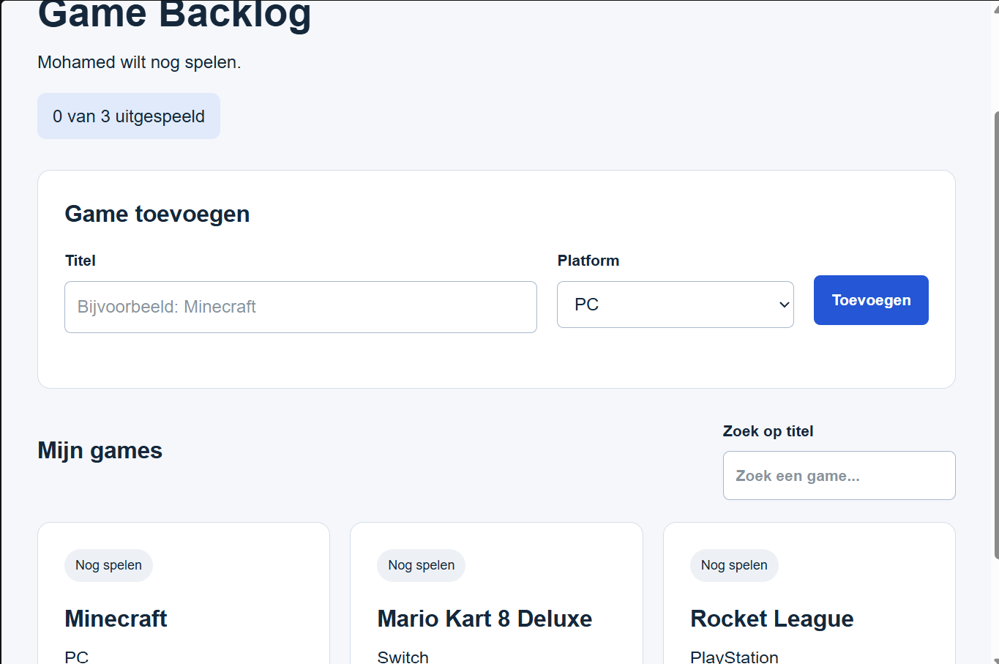
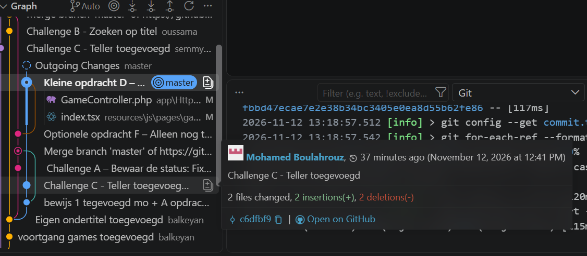

## Sem voortgang

## Oussama voortgang

## Beyan voortgang

## Mohamed voortgang

---
# kennischeck vragen 1

1. De template is het startproject van de docent. De repository is ons eigen project op GitHub. Een clone is een kopie op je computer.

2. Je partner ziet jouw wijzigingen pas nadat jij een push doet en hij of zij een pull uitvoert.

3. Er worden bestanden zoals .env, vendor, node_modules en een databasebestand aangemaakt.

4. De games staan in een lokale database op je eigen computer. Daarom komen ze niet automatisch op GitHub.

5. Laravel controleert of de titel goed is ingevuld. Daarna stuurt Laravel de games naar React om ze te laten zien.

---

# kennischeck vragen 2

1. De route stuurt de wijziging naar Laravel. Met `save()` wordt de nieuwe status opgeslagen in de database.

2. Inloggen betekent dat je een gebruiker bent. Eigenaar zijn betekent dat de game van jou is.

3. Props zijn gegevens die je krijgt (zoals `games`). State zijn gegevens die kunnen veranderen (zoals `search`).

4. `games` bevat alle games voor de voortgang. `visibleGames` bevat alleen de games die zichtbaar zijn na het zoeken.

5. Omdat zoeken alleen in React gebeurt. Er hoeft niets in de database opgeslagen te worden.

6. Ik heb zelf de opdrachten gemaakt, getest en via GitHub gedeeld met mijn partner.

---

- Repository: https://github.com/semmyOH/game-backlog-duo