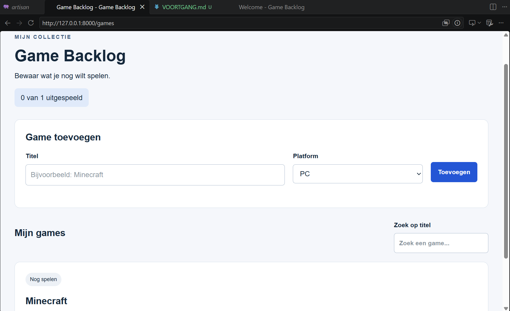
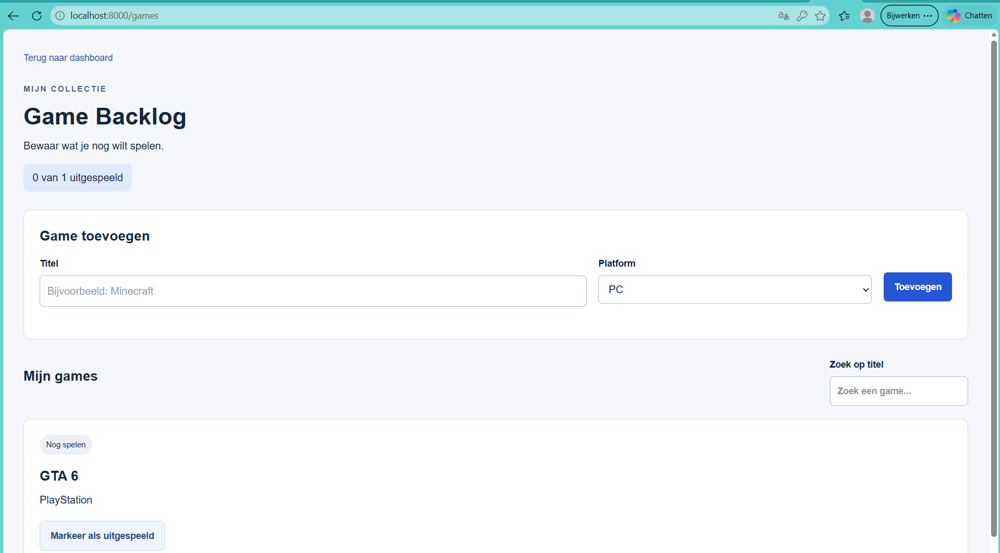

## Sem screenshot

## Oussama screenshot

## Beyan screenshot

1. Wat is het verschil tussen de docenten-template, jullie repository en een clone?
2. Waarom ziet je partner een wijziging pas na jouw push en diens pull?
3. Welke bestanden worden bij de installatie lokaal aangemaakt?
4. Waarom krijgt je partner jouw games niet via GitHub?
5. Waar wordt de titel gecontroleerd en hoe komen de games bij React terecht?

---

1. De template is het startproject van de docent. De repository is ons eigen project op GitHub. Een clone is een kopie op je computer.

2. Je partner ziet jouw wijzigingen pas nadat jij een push doet en hij of zij een pull uitvoert.

3. Er worden bestanden zoals .env, vendor, node_modules en een databasebestand aangemaakt.

4. De games staan in een lokale database op je eigen computer. Daarom komen ze niet automatisch op GitHub.

5. Laravel controleert of de titel goed is ingevuld. Daarna stuurt Laravel de games naar React om ze te laten zien.

---